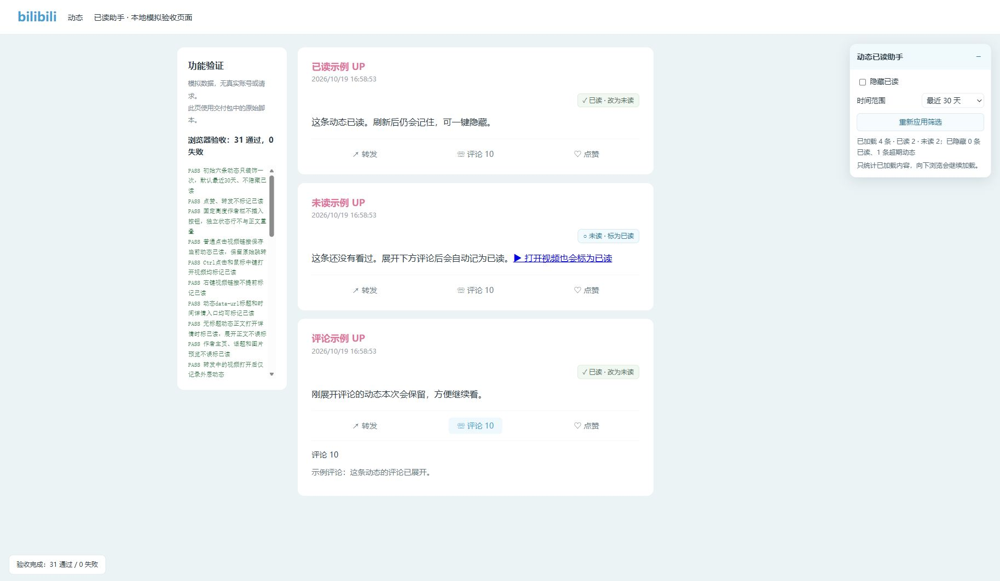

# B站动态已读助手

**记住看过的动态，下次接着看。** 一个运行在 B 站动态页上的 Microsoft Edge 扩展：记录已读、一键隐藏已读、按时间筛选，保持 B 站原来的动态顺序。

适合隔几天才打开 B 站、关注较多 UP 主，又不想每次从最新动态重新翻起的人。

[安装](#安装) · [详细使用说明](docs/安装与使用.md) · [问题反馈](https://github.com/bigplanesky/bilibili-feed-reader/issues)



*模拟数据演示，不包含真实账号信息。当前版本：1.0.1。*

## 能做什么

- **自动记已读**：评论区成功展开，或从卡片打开动态详情、视频时，记录这条动态。
- **手动纠正**：每条动态显示「未读／已读」，可随时切换。
- **一键隐藏已读**：下次回来优先浏览尚未看过的内容，取消开关即可恢复显示。
- **按时间筛选**：最近 7／30／90 天或全部，默认最近 30 天。超期只隐藏，不算已读。
- **继续寻找未读**：连续隐藏多批内容时，尝试触发 B 站原有分页；每轮最多补载 10 批，之后可点「继续查找未读」。
- **本机保存**：刷新、重开浏览器后保留记录；同一 Edge 配置的多个标签页同步状态。

首次安装默认**不隐藏已读**，之后会记住筛选选择。

## 安装

目前通过 Edge「加载解压缩的扩展」安装，尚未上架扩展商店。**普通使用不需要 Node.js、npm 或构建。**

1. 点击本仓库的 **Code → Download ZIP**，完整解压到一个长期保留的文件夹；也可以用 Git 克隆仓库。
2. 在 Edge 地址栏输入 `edge://extensions` 并打开。
3. 开启「开发人员模式」，点击「加载解压缩的扩展」。
4. 选择解压后**直接包含 `manifest.json` 的文件夹**，通常叫 `bilibili-feed-reader-main`。不要选择 ZIP 或它的上一级文件夹。
5. 打开 [B 站动态页](https://t.bilibili.com/)，登录并刷新，右侧会显示「动态已读助手」。

保留安装文件夹；Edge 会持续从这里加载扩展，不要移动或删除它。完整操作见 [安装与使用](docs/安装与使用.md)。

## 怎么用

**打开动态 → 展开评论或打开内容 → 下次开启「隐藏已读」继续看。**

| 操作 | 是否记为已读 |
| --- | --- |
| 点卡片底部评论按钮，评论区成功展开 | 是，空评论区也算 |
| 从卡片打开视频封面／标题、动态详情入口 | 是，视频链接支持 Ctrl 点击和鼠标中键 |
| 点击「标为已读」 | 是，可再改回未读 |
| 滚动、停留、点赞、转发 | 否 |
| 打开作者主页、话题、图片预览，或展开正文 | 否 |
| 评论加载失败或仍在加载 | 否 |
| 右键菜单选择「在新标签页打开」 | 暂不自动识别，请用 Ctrl 点击、中键或手动标记 |

**刚刚读过的动态不会立刻消失。** 开启「隐藏已读」时，本页新产生的已读继续保留，方便看完评论；刷新、重新进入页面或点击「重新应用筛选」后才会隐藏。

转发按**外层动态**的 ID 和转发时间记录，不会同时把原动态标成已读。

## 数据、权限与边界

- Manifest V3，只申请 `storage` 权限；页面脚本仅匹配 `https://t.bilibili.com/*`。
- 记录和设置使用 `chrome.storage.local` 保存在当前浏览器配置中。扩展不上传数据，不读取 Cookie、密码或视频观看记录，没有统计追踪和远程代码。
- 不同电脑、手机和浏览器配置之间不自动同步。同一 Edge 配置切换 B 站账号时，记录仍共用。
- 从启用后开始记录，无法追溯以前看过的动态。卸载扩展可能删除本地记录。
- 数量只统计**已加载的动态**，不代表全站未读总数；内容完整性取决于 B 站实际提供的动态流。
- 无法可靠识别的卡片保留可见；网站结构变化可能需要更新适配。后台标签页暂停自动补载。

适用范围是 B 站动态列表。当前以桌面版 Edge 验证，其他浏览器和移动端不作兼容保证。本项目为第三方工具，与哔哩哔哩及 Microsoft 无隶属关系。

## 更新

将新版文件覆盖到**原安装文件夹**，在 `edge://extensions` 点击扩展的「重新加载」，再刷新动态页。Git 安装可在原目录 `git pull` 后执行相同步骤。

不要通过卸载重装进行常规更新，以免丢失本地记录。

## 开发与验证

无需第三方依赖。安装 Node.js 18 或更新版本，在仓库根目录运行：

```sh
node --test tests/core.test.cjs
```

浏览器模拟检查：

```sh
node tests/server.cjs
```

打开 `http://127.0.0.1:8765/`，自动运行交互检查。模拟页不访问真实账号数据，退出服务器使用 Ctrl+C。

| 文件 | 职责 |
| --- | --- |
| `manifest.json` | 扩展配置和权限 |
| `core.js` | 已读、时间与筛选规则 |
| `background.js` | 存储写入与消息处理 |
| `adapter.js`、`bridge.js` | B 站页面及组件元数据适配 |
| `content.js`、`content.css` | 标记、工具栏、交互和分页 |
| `tests/` | Node.js 检查和浏览器模拟页 |
| `docs/` | 使用、实现、验证说明和演示图 |

已通过 32 项 Node.js 检查、31 项浏览器模拟检查；历史验收另包含页面持久化检查和登录态 Edge 抽查。覆盖范围见 [验证结果](docs/验证结果.md)，实现细节见 [实现说明](docs/实现说明.md)，版本变化见 [CHANGELOG](CHANGELOG.md)。

## 反馈与参与

遇到问题请 [提交 Issue](https://github.com/bigplanesky/bilibili-feed-reader/issues)，说明 Edge 版本、扩展版本、动态类型、操作步骤和实际结果。截图请遮住个人信息，不要上传 Cookie、登录凭据或完整浏览器存储。

欢迎提交页面适配、兼容性和文档改进的 PR。提交前请运行自动检查；涉及页面行为时，同时运行模拟页并说明真实页面验证范围。

## 许可证

[MIT](LICENSE) © 2026 [bigplanesky](https://github.com/bigplanesky)。允许修改、分发和商用，需保留版权与许可声明。
